# Why nanoGPT trains four next tokens at once

> Reading on GitHub: SVG trace frames are static. GIF previews can animate; interactive steppers and video controls run in HTML. Use the static frames, GIF previews and MP4 links below. For the interactive version, clone the repo and open this folder's `article.html` with its adjacent `article.assets/` folder; open standalone players locally too.


A decoder generates one token at a time, but a training call can predict the next token at every input position. Understanding that distinction connects the data loader, causal mask, loss, and parameter update. It also explains why a context window of four tokens produces four supervised errors rather than one.

We will follow a tiny batch through nanoGPT at commit `3adf61e154c3fe3fca428ad6bc3818b27a3b8291`. The measured run uses a CPU, float32, one decoder block, and eight invented token classes. It needs neither pretrained weights nor downloaded text. The full training process has additional work around this update, including evaluation and checkpointing. Here the question is smaller: **how do two windows become eight predictions and one weight update?**

## The answer starts one token to the right

Imagine the token stream below as a binary file containing unsigned 16-bit integers:

```text
stream = [0,1,2,3,4,5,6,7,0,1,2,3]
```

These IDs form a constructed fixture, not a real tokenizer vocabulary. With batch size B=2 and context length T=4, the original loader samples two starting offsets. Resetting the random seed to 1337 gives offsets 7 and 5:

```text
X = [[7,0,1,2], [5,6,7,0]]
Y = [[0,1,2,3], [6,7,0,1]]
```

The targets Y already hold the next token for each input in X. Position zero in the first window receives token 7 and predicts token 0. Its final position receives token 2 and predicts token 3, which exists just beyond the input window.

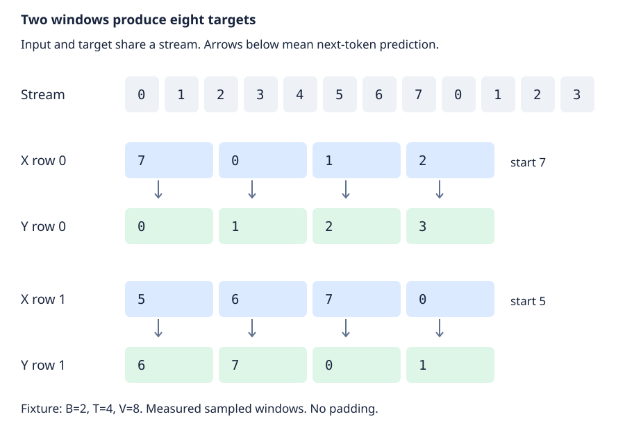

*Fixture IDs with measured sampled windows. Each input column has its own next-token target. The final target lies one position beyond its input window.*

The key operation in [`get_batch` in train.py](https://github.com/karpathy/nanoGPT/blob/3adf61e154c3fe3fca428ad6bc3818b27a3b8291/train.py) is short:

```python
# train.py  get_batch
ix = torch.randint(len(data) - block_size, (batch_size,))
x = torch.stack([torch.from_numpy((data[i:i+block_size]).astype(np.int64)) for i in ix])
y = torch.stack([torch.from_numpy((data[i+1:i+1+block_size]).astype(np.int64)) for i in ix])
```

There is no extra label shift inside the loss function. The loader shifts the slice itself. Its random upper bound excludes offsets that would place the final target outside the file. The uint16 storage becomes int64 tensors suitable for embedding lookup. This path uses fixed-length windows with no padding and no separate document mask.

## One position becomes an eight-component vector

Our tiny decoder has D=8 channels, H=2 attention heads, and L=1 block. Each head has K=D/H=4 channels. Vocabulary size V=8 means the output has eight scores at every position. These are fixture overrides, not nanoGPT defaults.

A token embedding supplies an eight-component vector for each class. A learned position embedding supplies another vector for positions 0 through 3. [`GPT.forward` in model.py](https://github.com/karpathy/nanoGPT/blob/3adf61e154c3fe3fca428ad6bc3818b27a3b8291/model.py) adds them, broadcasting position vectors across both windows:

```python
# model.py  GPT.forward
pos = torch.arange(0, t, dtype=torch.long, device=device) # shape (t)

# forward the GPT model itself
tok_emb = self.transformer.wte(idx) # token embeddings of shape (b, t, n_embd)
pos_emb = self.transformer.wpe(pos) # position embeddings of shape (t, n_embd)
x = self.transformer.drop(tok_emb + pos_emb)
```

The shapes are `[B,T,D]=[2,4,8]` for token vectors and `[T,D]=[4,8]` for position vectors. Their sum has `[2,4,8]`. With dropout disabled, its first vector begins `[0.010869,−0.020151,0.004939,0.011523]` in the measured run.

Position zero means the beginning of the sampled window. It does not preserve the window's absolute offset in the stream. Both sampled windows start with the same learned position-zero vector.

## The causal mask makes the targets legitimate

All four positions travel through the block together. That parallel calculation would leak answers if an early position could read later input tokens. Causal attention prevents that leak by restricting query position t to key positions 0 through t.

The block normalizes channels before attention. A linear layer computes query, key, and value vectors, then splits them into two heads. Each Q, K, or V tensor has shape `[B,H,T,K]=[2,2,4,4]`. Attention scores are `QKᵀ/√K`. Here √K=2. The mask excludes scores above the diagonal, and softmax normalizes each remaining row.

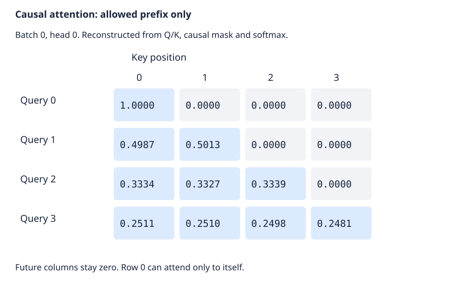

*Measured reconstruction for batch zero, head zero. Rows are query positions and columns are key positions. Zeros above the diagonal keep future inputs unavailable. These probabilities were reconstructed from projections and the mask, not returned by the SDPA API.*

Query zero can attend only to key zero, so its attention probability is exactly one. Query one can mix keys zero and one, with measured probabilities 0.498675 and 0.501325. Later rows have longer permitted prefixes.

[`CausalSelfAttention.forward` in model.py](https://github.com/karpathy/nanoGPT/blob/3adf61e154c3fe3fca428ad6bc3818b27a3b8291/model.py) selects the scaled dot-product attention API when PyTorch provides it:

```python
# model.py  CausalSelfAttention.forward
if self.flash:
    # efficient attention using Flash Attention CUDA kernels
    y = torch.nn.functional.scaled_dot_product_attention(q, k, v, attn_mask=None, dropout_p=self.dropout if self.training else 0, is_causal=True)
```

The field name `flash` and the CUDA comment can mislead a CPU reader. Its constructor checks API availability, not whether the model runs on a GPU. Our run takes this API branch on the CPU. It does not establish use of a CUDA Flash Attention kernel.

After joining the heads, the block projects back to D=8 channels and adds its input through a residual connection. A second normalization feeds an MLP that expands eight channels to 32, applies GELU, and contracts back to eight. Another residual addition completes the block:

```python
# model.py  Block.forward
x = x + self.attn(self.ln_1(x))
x = x + self.mlp(self.ln_2(x))
return x
```

Every operation preserves the four-position sequence, except the MLP's temporary channel expansion. A final normalization produces hidden states `[2,4,8]`. The measured first final vector begins `[0.411401,−0.900618,0.089378,0.389201]`.

We checked the causality conclusion directly: changing the last input token left all earlier logits unchanged within the recorded tolerance. That verifies future-token isolation for this fixture. It does not test every possible attention branch.

## Eight predictions become one scalar

The vocabulary head transforms each hidden vector into V=8 logits. A logit is an unnormalized score for one next-token class. Training returns `[B,T,V]=[2,4,8]`, so both windows contribute all four positions.

```python
# model.py  GPT.forward
if targets is not None:
    # if we are given some desired targets also calculate the loss
    logits = self.lm_head(x)
    loss = F.cross_entropy(logits.view(-1, logits.size(-1)), targets.view(-1), ignore_index=-1)
```

Flattening B and T gives eight rows of eight logits and eight target IDs. Cross entropy converts logits to log probabilities internally. The fixture contains no ignored labels, so all eight positions enter the mean.

For the first position, the correct class is zero and its measured probability is 0.138861. Its negative log probability is `−log(0.138861)=1.974284` nats. Natural logarithms give the unit "nats." The eight position errors are:

```text
[[1.974284,2.007585,2.104710,2.133002],
 [2.076542,2.093054,2.034803,2.030884]]
```

Their average is **2.056858 nats per target**. The validation independently averaged negative log probabilities and matched the original cross-entropy result. That links the scalar loss back to the eight targets shown in the first figure.

Inference chooses a different head branch. When targets are absent, the same forward computes hidden states for the sequence but projects only `x[:,[-1],:]`. It returns `[B,1,V]=[2,1,8]` logits and no loss. Training uses known next-token labels to supervise every position. Generation uses the final position to choose a continuation.

## The scalar changes shared weights

The output head and token embedding share one Parameter, as [`GPT.__init__` in model.py](https://github.com/karpathy/nanoGPT/blob/3adf61e154c3fe3fca428ad6bc3818b27a3b8291/model.py) explicitly assigns:

```python
# model.py  GPT.__init__
self.transformer.wte.weight = self.lm_head.weight # https://paperswithcode.com/method/weight-tying
```

One backward pass therefore accumulates both uses into the same gradient tensor. The tiny model contains 888 distinct scalar parameters, including learned positions. This count avoids a second token/head matrix because of that sharing.

The source update order is forward, next-batch fetch, backward, gradient clipping, optimizer step, and gradient clearing. On the CPU these calls are sequential. Reassigning X and Y to the next batch does not change the tensors already retained by the current computation graph.

Our validation executes one float32 update directly, without the full script's evaluation or prefetch side effects. It uses the original optimizer factory and source-extracted learning-rate function. A miniature schedule has peak LR=0.004 and three warmup iterations. Its first value is `0.004×(0+1)/(3+1)=0.001`.

Backward produces finite gradients for every parameter. The total gradient norm is 1.218671. Clipping to a bound of one brings it to 0.999999 before AdamW steps. Matrix parameters receive weight decay 0.1, while vector parameters receive zero decay. This grouping includes both embedding tables. CPU uses ordinary AdamW rather than its fused CUDA option.

The largest absolute token-weight change is 0.001004860. After `zero_grad(set_to_none=True)`, gradients are None. Re-evaluating the same batch gives loss **2.044125**, down from 2.056858.

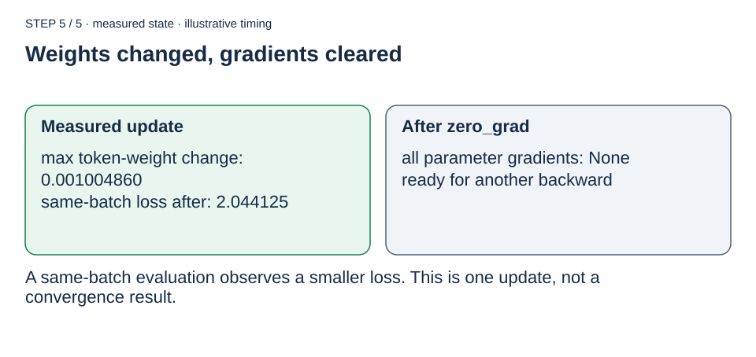

*The measured update ends with changed parameters and cleared gradients. The snapshots describe execution states, not elapsed times or CPU/GPU overlap.*

<details>
<summary>Read all 5 trace states as static figures</summary>

**1. Two sampled windows**

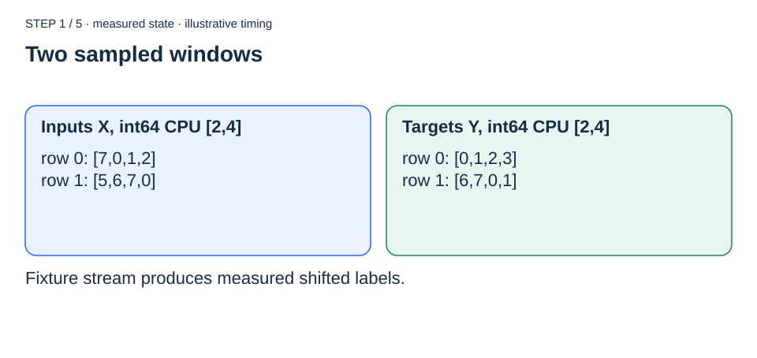

Fixture stream produces measured shifted labels.

**2. Forward creates a scalar loss**

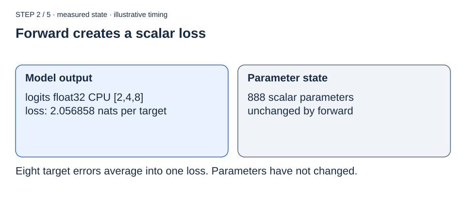

Eight target errors average into one loss. Parameters have not changed.

**3. Backward writes gradients**

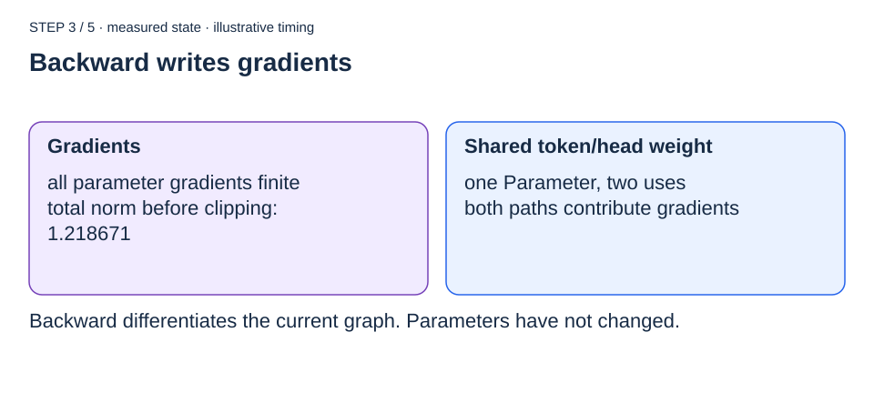

Backward differentiates the current graph. Parameters have not changed.

**4. Clipping precedes AdamW**

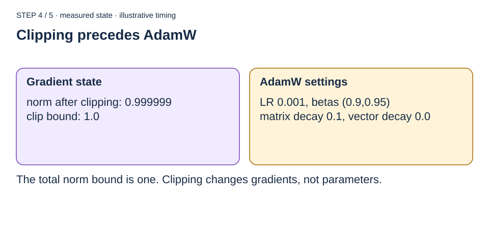

The total norm bound is one. Clipping changes gradients, not parameters.

**5. Weights changed, gradients cleared**


A same-batch evaluation observes a smaller loss. This is one update, not a convergence result.

</details>

<!-- explain-html-only
<iframe src="assets/update-player.html" title="Step through the tiny training update" height="650" sandbox="allow-scripts" loading="lazy"></iframe>
-->

[Open the update stepper](assets/update-player.html). Its presentation durations are illustrative. It does not autoplay. Browser playback and controls have not been verified in this evaluation environment.


## What this run establishes

The reproducible [external validation](validate_step.py) ships beside this article. Set `NANO_REPO` to the pinned original checkout and run:

```sh
python validate_step.py --repo "$NANO_REPO" --output assets/measurement.json
```

It uses Python 3.12.5, PyTorch 2.14.1, NumPy 2.5.3, and one CPU thread on Darwin arm64. Batch sampling and model initialization each reset seed 1337. Those separate resets make this fixture reproducible, but differ from the full process's RNG sequence. The stream IDs are invented, while windows, activations, probabilities, gradients, and losses are measured. Raw results are in [measurement.json](assets/measurement.json).

Thirteen assertion groups passed, covering windows and types, weight identity, tensor shapes, cross entropy, causal isolation, the inference branch, learning rate, optimizer groups, finite gradients, clipping, an actual parameter change, gradient clearing, and lower same-batch loss. This is an external check. The upstream scanner found no repository tests.

The full `train.py` process was not run. Validation and text preparation, exhaustive sampler boundaries, manual attention, nonzero dropout, ignored-label cases, gradient accumulation, mixed precision, DDP, and checkpoint/resume remain gaps. No GPU speed or generalization claim follows from one successful update. HTML generation and static SVG inspection passed, while browser security prevented rendered HTML and interactive-control inspection.

The useful implementation lesson is that training's parallelism comes from the combination of shifted targets and causal visibility. Each position learns from its own allowed prefix. The eight supervised predictions meet in one mean loss, and that loss updates the same parameters that will later generate one token at a time.

## Optional renderer demonstrations

The figures and state trace above explain this article's selected path. These
short clips demonstrate the optional Manim backend; they do not establish the
quality of a complete architecture, concurrency or mathematical explainer.
A real article does not need a video when its figures already teach the mechanism.

<details>
<summary>Show the optional rendering demos, GIF previews and MP4 links</summary>

### Token flow and illustrative attention

[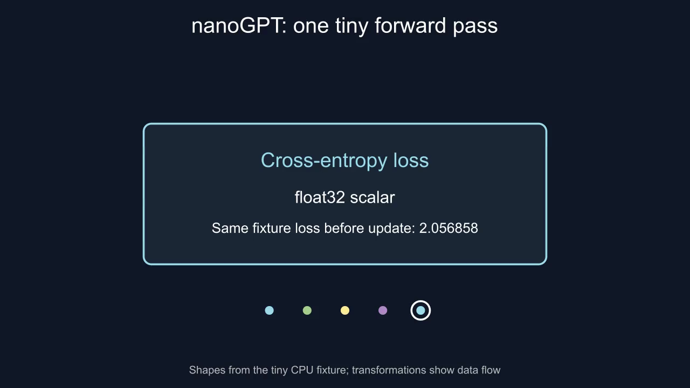](assets/token-flow.mp4?raw=1)

[Watch or download the MP4 (14.4 seconds)](assets/token-flow.mp4?raw=1).

<details>
<summary>Show animated GIF preview (loops automatically when visible)</summary>

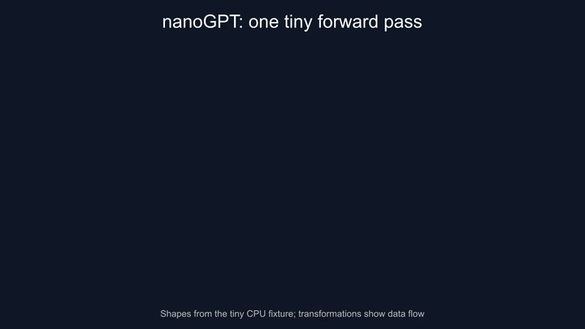

GIF timings are illustrative, as in the original clip. Use the MP4 for the full-resolution video.

</details>

<!-- explain-html-only
<figure>
  <video controls playsinline preload="metadata" poster="assets/token-flow.poster.png">
    <source src="assets/token-flow.mp4" type="video/mp4">
    <a href="assets/token-flow.mp4">Open the forward-pass animation</a>
  </video>
  <figcaption>Original Manim scene using the same tiny batch and source-supported shapes. Smooth transformations show data flow, not literal memory movement.</figcaption>
</figure>
-->

The [editable specification](assets/token-flow.scene.json) and [scene source](assets/token-flow.scene.py) and [reproducible source bundle](assets/token-flow.sources.zip) retain the stage definitions. Static window and attention figures explain the same fixture without playback.

For a separate mathematical toy, the next scene computes dot products, a causal mask, row softmax and weighted values from three two-dimensional Q/K/V rows. Its inputs are illustrative; they are not the measured model activations above. The [computed metadata](assets/attention.metadata.json) records the numerical results; the [source bundle](assets/attention.sources.zip) includes the editable inputs and renderer.

[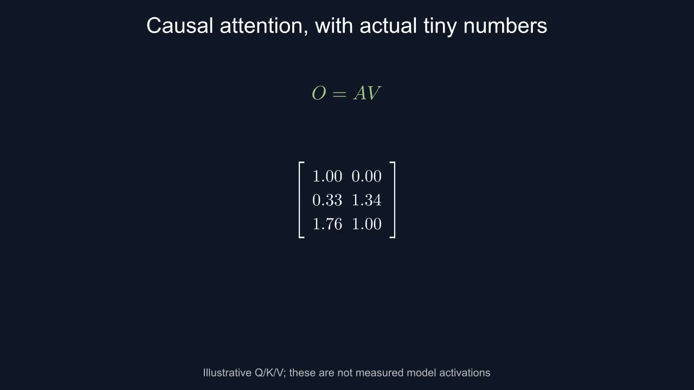](assets/attention.mp4?raw=1)

[Watch or download the MP4 (15.9 seconds)](assets/attention.mp4?raw=1).

<details>
<summary>Show animated GIF preview (loops automatically when visible)</summary>

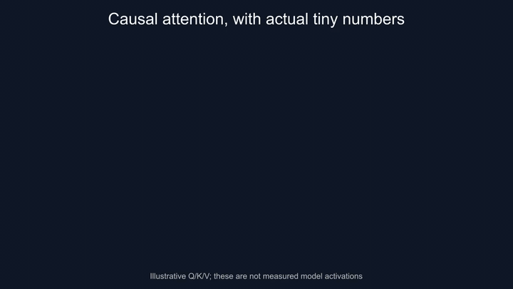

GIF timings are illustrative, as in the original clip. Use the MP4 for the full-resolution video.

</details>

<!-- explain-html-only
<figure>
  <video controls playsinline preload="metadata" poster="assets/attention.poster.png">
    <source src="assets/attention.mp4" type="video/mp4">
    <a href="assets/attention.mp4">Open the tiny attention calculation</a>
  </video>
  <figcaption>A separate illustrative Q/K/V example, with actual calculated values and smooth mathematical transformations. Timings are for presentation.</figcaption>
</figure>
-->

</details>
