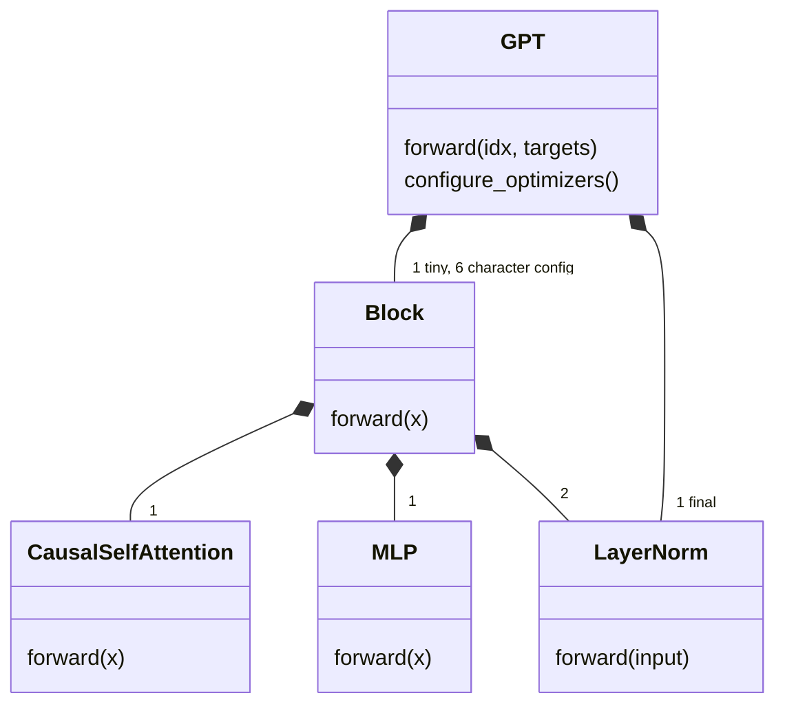
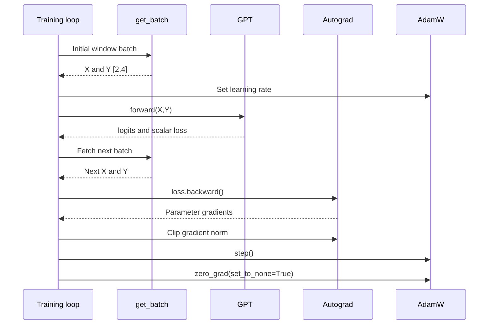

# nanoGPT: one small CPU training step

This source walkthrough follows a batch of token windows through a decoder, loss, gradients, and one AdamW update. It targets engineers who know tensors and want to verify nanoGPT's training path.

Commit: `3adf61e154c3fe3fca428ad6bc3818b27a3b8291`. Mode: `deep`. Audience: ML engineers new to this repository.
Scope: one CPU update, float32, one block, no compilation or distributed processes.
Source: [karpathy/nanoGPT at the explained commit](https://github.com/karpathy/nanoGPT/tree/3adf61e154c3fe3fca428ad6bc3818b27a3b8291).

## Contents

- [Mental model](#mental-model)
- [Big picture](#big-picture)
- [Running example](#running-example)
- [Doc map](#doc-map)
- [Key sequences](#key-sequences)
- [Test coverage](#test-coverage)
- [Gaps](#gaps)
- [Shapes cheat sheet](#shapes-cheat-sheet)
- [Out of scope](#out-of-scope)

## Mental model

A training step turns a few text windows into slightly changed model weights.
The model guesses what comes next, compares its guesses with the known next
tokens, and uses those errors to adjust its weights.

1. **Make examples.** The loader cuts token windows from a file and pairs each window with the same window shifted one token forward.
2. **Make predictions.** The model guesses the next token at every position. Each position can use only its earlier context and itself.
3. **Measure mistakes.** The loss combines the errors into one number.
4. **Change the weights.** Backward computes gradients, which describe how weights affect the loss. Clipping limits their total size; AdamW applies the update and clears the gradients for the next step.

**Small example (measured fixture).** Input `[7,0,1,2]` has targets `[0,1,2,3]`.
There are two windows, so the model makes eight predictions. This update changes a model with
888 parameters; the loss on the same batch falls from 2.056858 to
2.044125. That is a fixture result, not a convergence or generalization claim.

## At a glance

| Knob | Tiny validation | Repository source | Meaning |
|---|---|---|---|
| Batch and context | B=2, T=4 | `batch_size`, `block_size` in `train.py` | Eight target predictions |
| Model | L=1, D=8, H=2, V=8 | `GPTConfig` in `model.py` | Small fixture model |
| Random seed | 1337 | `torch.manual_seed` in `train.py` | Same seed, reset separately for batch and initialization |
| Precision | float32 on CPU | `ctx` in `train.py` | CPU uses `nullcontext`, not autocast |
| Dropout and bias | 0.0, False | Fixture overrides | Deterministic validation, no linear or norm biases |
| Accumulation | A=1 | Fixture override | One batch per update |
| Optimizer | AdamW, LR=0.001, decay=0.1 | `GPT.configure_optimizers` | Betas=(0.9,0.95) |
| PyTorch | 2.14.1 | Installed validation runtime | SDPA API path, CPU kernels |

These values deliberately shrink the README's CPU example. They are not nanoGPT defaults. The character config uses B=64, T=256, L=6, H=6, D=384. Its preparation script reports V=65 for the original text.

## Big picture

```mermaid
flowchart LR
    stream["uint16 token stream"] -->|"two windows"| batch["X and Y int64 [2,4]"]
    batch -->|"X"| gpt["GPT forward"]
    gpt -->|"logits [2,4,8]"| ce["Cross entropy with Y"]
    ce -->|"scalar loss"| backward["Backward"]
    backward -->|"parameter gradients"| clip["Clip total norm to 1"]
    clip -->|"clipped gradients"| adam["AdamW step"]
    adam -->|"updated parameters"| clear["Clear gradients"]
```



Arrows mean data dependency. They do not represent CPU/GPU overlap. The original loop fetches its next batch between forward and backward. On this CPU path, those calls execute sequentially.

## Running example

The fixture stream is `[0,1,2,3,4,5,6,7,0,1,2,3]`, stored as uint16. IDs denote eight invented token classes. They are not Shakespeare characters or GPT-2 BPE IDs.

| State | Actual object |
|---|---|
| Measured batch from original loader | X=`[[7, 0, 1, 2], [5, 6, 7, 0]]`, Y=`[[0, 1, 2, 3], [6, 7, 0, 1]]` |
| Measured logits | float32 CPU `[2,4,8]`, first vector `[0.15, 0.0385, -0.0347, 0.111, 0.0633, -0.045, -0.0148, 0.0732]` |
| Measured loss before update | 2.056858 nats per target |
| Measured gradient norm | 1.218671 before clipping, 0.999999 after |
| Measured same-batch loss after update | 2.044125 nats per target |

Initialization and batch sampling each reset seed 1337. This isolates the example from setup-time random draws. The full training process does not perform those two separate resets. Rounded display values come from [measurement.json](assets/measurement.json).


Figure: fixture IDs, measured sampled windows. Each column predicts the token directly to its right in the stream.

## Doc map

| Doc | Covers | Entry point | Read when |
|---|---|---|---|
| [train.md](train.md) | windows, learning rate, gradients, optimizer | `get_batch` and the module-level loop | Changing data or updates |
| [model.md](model.md) | embeddings, causal block, head and loss | `GPT.forward` | Changing tensor flow |
| [evidence.json](evidence.json) | source claims, example provenance, gaps | Evidence ledger | Revising this explanation |

## Major components

| Component | Job in plain words | Receives | Produces | Source |
|---|---|---|---|---|
| `get_batch` | Cut windows and pair them with next tokens | Flat token file and sampled offsets | Input and target tensors `[2,4]` | `train.py` |
| `GPT` | Predict next tokens and measure their errors | IDs and targets `[2,4]` | Scores `[2,4,8]` and scalar loss | `model.py` |
| `Block` | Mix allowed context, then transform each position | Hidden vectors `[2,4,8]` | Updated vectors with the same shape | `model.py` |
| `CausalSelfAttention` | Combine information from this position and earlier ones | Hidden vectors | Context-mixed vectors, same shape | `model.py` |
| `MLP` | Expand channels, apply GELU, and reduce channels | Eight-channel hidden vectors | Eight-channel transformed vectors | `model.py` |
| `LayerNorm` | Normalize a position's channel values | Hidden vectors | Normalized vectors, same shape | `model.py` |
| `get_lr` | Choose the learning rate for this iteration | Iteration and schedule settings | One learning-rate value | `train.py` |



## Key sequences



This depicts source call order with the float32 scaler acting as a no-op. The validation runs the same mathematical update directly. It omits next-batch prefetch and does not execute `train.py` as a process.

## End-to-end data flow

| Step | Input | Output | Code | Doc |
|---|---|---|---|---|
| train.A1 | uint16 stream | int64 X,Y `[2,4]` | `get_batch` | [train.md](train.md) |
| model.A1 | X `[2,4]`, generated positions `[4]` | embeddings `[2,4,8]` | `GPT.forward` | [model.md](model.md) |
| model.A2 | embeddings | final normalized hidden `[2,4,8]` | `Block.forward`, `LayerNorm.forward` | [model.md](model.md) |
| model.A3 | hidden, Y | logits `[2,4,8]`, scalar loss | `GPT.forward` | [model.md](model.md) |
| train.B1 | iteration 0, model parameters | AdamW groups and LR=0.001 | `get_lr`, `GPT.configure_optimizers` | [train.md](train.md) |
| train.B2 | scalar loss and parameters | changed weights, gradients=None | module-level loop | [train.md](train.md) |

## Test coverage

Run from this documentation folder after setting `NANO_REPO` to the checkout:

```sh
python tests/validate_step.py --repo "$NANO_REPO" --output assets/measurement.json
```

| Step | Test | Command | Status |
|---|---|---|---|
| train.A1 | Original loader, shape, dtype and shift assertions | Shared validation command above | pass |
| model.A1 | Hooked embedding shapes and tied-weight identity | Shared validation command above | pass |
| model.A2 | Block/MLP shapes and causal prefix invariance | Shared validation command above | pass |
| model.A3 | Explicit negative log probabilities and inference shape | Shared validation command above | pass |
| train.B1 | Source LR and optimizer dimensional groups | Shared validation command above | pass |
| train.B2 | Finite grads, clip bound, update, clear, loss decrease | Shared validation command above | pass |

Summary: six documented steps, six with passing external validation. One tiny CPU update passed 13 assertion groups. The scanner found zero upstream test files. No upstream tests were failed or skipped. This is an external validation script, not an added repository test.

## Gaps

| Step | Missing test or open question | Proposed test and assertion |
|---|---|---|
| train.A1 | Exhaustive sampler boundaries and validation split | `test_loader_offsets`: enumerate permitted starts and verify final target access |
| model.A2 | Older manual attention branch and nonzero dropout | `test_attention_parity`: SDPA and manual causal outputs agree with dropout disabled |
| model.A3 | Ignored targets and all-ignored batch | `test_loss_ignore`: mean uses valid positions only and defines the empty case |
| train.B2 | Full process execution, evaluation RNG, scaler and accumulation | `test_train_process`: two fixture iterations follow source cadence with correct averaged gradients |
| train.B2 | Checkpoint and resume | `test_resume_roundtrip`: reload model and optimizer and reproduce next update |

## Glossary

| Term | Meaning | Code name |
|---|---|---|
| Context window | Consecutive input positions | `block_size` |
| Micro-batch | One model call before accumulated update | `batch_size` |
| Vocabulary | Number of output token classes | `vocab_size` |
| Causal | Position cannot use later input tokens | `is_causal=True` |
| Weight tying | Token embedding and output projection share one Parameter | `wte.weight`, `lm_head.weight` |
| SDPA | Scaled dot-product attention API | `scaled_dot_product_attention` |
| Nats | Negative log probability with natural logarithms | Cross entropy output |

## Shapes cheat sheet

B=batch, T=context, D=channels, H=heads, K=D/H=head channels, V=vocabulary, L=blocks, A=accumulation.

| Tensor | Named shape | Tiny | Character config | Created by |
|---|---|---|---|---|
| X,Y | `[B,T]` | `[2,4]` | `[64,256]` | `get_batch` |
| Position IDs | `[T]` | `[4]` | `[256]` | `GPT.forward` |
| Token embeddings | `[B,T,D]` | `[2,4,8]` | `[64,256,384]` | `wte` |
| Position embeddings | `[T,D]` | `[4,8]` | `[256,384]` | `wpe` |
| Q,K,V individually | `[B,H,T,K]` | `[2,2,4,4]` | `[64,6,256,64]` | `CausalSelfAttention.forward` |
| Logical attention weights | `[B,H,T,T]` | `[2,2,4,4]` | `[64,6,256,256]` | Attention formula, not explicitly exposed by SDPA |
| MLP expansion | `[B,T,4D]` | `[2,4,32]` | `[64,256,1536]` | `MLP.c_fc` |
| Hidden states | `[B,T,D]` | `[2,4,8]` | `[64,256,384]` | Block and final norm |
| Training logits | `[B,T,V]` | `[2,4,8]` | `[64,256,65]` | `lm_head` with targets |
| Flattened logits | `[BT,V]` | `[8,8]` | `[16384,65]` | `GPT.forward` loss branch |
| Inference logits | `[B,1,V]` | `[2,1,8]` | `[64,1,65]` | `lm_head` without targets |

## Coverage of existing docs

| Topic | Existing doc | Covered here | Note |
|---|---|---|---|
| `get_batch`, `block_size`, CPU settings | `README.md` quick start | train.A1, fixture settings | Source defines the exact windows |
| `compile` | `README.md` troubleshooting | Out of scope | Disabled here |
| `uint16` | `README.md` reproducing GPT-2 | train.A1 | Binary IDs become int64 tensors |
| `meta.pkl` | `data/shakespeare_char/prepare.py` | train.A1 | Vocabulary metadata, not batch contents |
| DDP | `README.md` reproducing GPT-2 | Out of scope | No distributed validation |
| `init_from` | `README.md` finetuning | Out of scope | Random initialization only |
| `sample.py` | `README.md` sampling / inference | Out of scope | Model's loss-free branch checked, sampler not run |

The README provides usage examples. This walkthrough uses the recorded code commit as the source of truth for behavior.

## Out of scope

The `train.py` alternatives include DDP, CUDA autocast, gradient scaling, compilation, resume, and pretrained initialization. Evaluation and checkpoint storage also remain outside this measured update. `sample.py` generates text, which this walkthrough does not run. OpenWebText preprocessing, model benchmarks, notebooks, and historical speed claims remain outside the selected path.

The source checks evaluation before each update at matching iteration numbers. Checkpoint dictionaries contain model, optimizer, model arguments, iteration, best validation loss, and config. The termination check occurs after incrementing `iter_num` and uses `iter_num > max_iters`. Therefore a fresh full process with `max_iters=0` performs one update unless `eval_only=True`. These statements are source-reviewed, not process-tested.

## Refreshing this doc

Re-run scan_ml_repo.py, the validation command, `check_explain_doc.py --repo "$NANO_REPO" --mode deep`, evidence collection, and render_html.py. Compare source changes against the Commit above. Keep [evidence.json](evidence.json) and [measurement.json](assets/measurement.json) with the Markdown. The HTML renderer loads diagram, math, and highlighting libraries from CDNs. Its generated page needs browser network access for those features.
