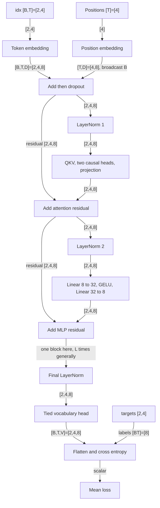

# Model: token IDs to eight next-token predictions

Paths are relative to the nanoGPT repository root. This document explains the model math. [train.md](train.md) follows file loading and the parameter update.

## Contents

- [Architecture](#architecture)
- [model.A Forward and loss](#modela-forward-and-loss)
- [Parameters and alternatives](#parameters-and-alternatives)

## Architecture

The model turns each input token into a prediction of the next token.

1. Add token and position vectors so the model knows what is where.
2. Mix information from allowed earlier positions, then transform each position.
3. Score every token class and compare those scores with the known next tokens.

**Example (measured fixture).** Two input windows of four IDs become logits
`[2,4,8]`: eight scores at each position. Comparing them with two target
windows gives one scalar loss. Shapes and formulas below show how.


| Input channel | Tiny shape | Used? | Switch / owner |
|---|---|---|---|
| `idx` | int64 `[B,T]=[2,4]` | Yes | Required argument to `GPT.forward` |
| `targets` | int64 `[B,T]=[2,4]` | Yes | Non-None enables all-position logits and loss |
| Positions | int64 `[T]=[4]` | Yes | Constructed inside forward, learned `wpe` embeddings |
| External masks, cache, side inputs | None | Absent | Not arguments to this forward |



The residual section is one block, repeated L times. Tensor edges describe data dependencies, not distinct allocations.

```text
idx int64 [2,4]
  -> token embedding float32 [2,4,8]
positions int64 [4] -> position embedding [4,8]
  -> sum, broadcast across batch [2,4,8]
  -> LayerNorm -> QKV [2,4,24]
  -> Q,K,V each [2,2,4,4]
  -> causal attention, join heads [2,4,8]
  -> projection, residual add [2,4,8]
  -> LayerNorm -> Linear [2,4,32] -> GELU -> Linear [2,4,8]
  -> residual add -> final LayerNorm [2,4,8]
  -> tied Linear [2,4,8] -> flatten logits [8,8], labels [8]
  -> scalar cross entropy
```

Dimensions: B=2 windows, T=4 positions, D=8 channels, H=2 heads, K=D/H=4 channels per head, V=8 token classes, L=1 block. The character config has B=64,T=256,D=384,H=6,K=64,L=6, and original prepared V=65.

## model.A Forward and loss

Turn token IDs into scores, then measure whether the known next tokens score well.

1. Combine token and position vectors.
2. Apply the causal decoder block and final normalization.
3. Produce vocabulary scores and compare them with the targets.

**Input/output (measured fixture).** IDs and targets `[2,4]` produce scores
`[2,4,8]` and an initial scalar loss of 2.056858.


### model.A1 Embed tokens and positions (`model.py`)

**Idea.** Token embeddings identify token classes. Position embeddings identify locations within each sampled window.

**Input.** X=`[[7, 0, 1, 2], [5, 6, 7, 0]]` on CPU. Position IDs reset to `[0,1,2,3]` for both windows.

**Output.** Float32 CPU sum `[B,T,D]=[2,4,8]`. Measured first vector, rounded:

```text
[0.010869,-0.020151,0.004939,0.011523,0.019955,0.040634,-0.014433,-0.034709]
```

**Code.**

```python
# model.py  GPT.forward
device = idx.device
b, t = idx.size()
assert t <= self.config.block_size, f"Cannot forward sequence of length {t}, block size is only {self.config.block_size}"
pos = torch.arange(0, t, dtype=torch.long, device=device) # shape (t)

# forward the GPT model itself
tok_emb = self.transformer.wte(idx) # token embeddings of shape (b, t, n_embd)
pos_emb = self.transformer.wpe(pos) # position embeddings of shape (t, n_embd)
x = self.transformer.drop(tok_emb + pos_emb)
```

```python
# model.py  GPT.__init__
self.lm_head = nn.Linear(config.n_embd, config.vocab_size, bias=False)
# with weight tying when using torch.compile() some warnings get generated:
# "UserWarning: functional_call was passed multiple values for tied weights.
# This behavior is deprecated and will be an error in future versions"
# not 100% sure what this is, so far seems to be harmless. TODO investigate
self.transformer.wte.weight = self.lm_head.weight # https://paperswithcode.com/method/weight-tying
```

The embedding tables have shapes `[V,D]=[8,8]` and `[block_size,D]=[4,8]`. Position lookup produces `[4,8]`, which broadcasts over B. Token embedding and vocabulary projection share the same Parameter. The assertion limits T to configured context length.

**Example.** At position zero in the first window, the input class is 7. The model adds row 7 of the token table to row 0 of the position table. Dropout=0 leaves the sum unchanged.

**Math.** `h[b,t,d]=W_token[X[b,t],d]+W_position[t,d]`. The first result component is measured as 0.010869. LayerNorm later transforms the whole eight-component vector, not each component independently.

**Tests.** External validation: `python tests/validate_step.py --repo "$NANO_REPO" --output assets/measurement.json` — **pass**. This script ships with these docs, outside the checkout. Set `NANO_REPO` to the original checkout. No upstream test suite exists at this commit.

### model.A2 Apply one causal decoder block (`model.py`)

**Idea.** Attention combines information from allowed input positions. The MLP transforms channels independently at each position. Residual additions preserve a direct path around both transformations.

**Input.** Float32 CPU embeddings `[2,4,8]` from model.A1.

**Output.** Float32 CPU hidden states `[2,4,8]` after the block and final normalization. Measured first final vector:

```text
[0.411401,-0.900618,0.089378,0.389201,0.718212,1.671423,-0.662723,-1.716273]
```

**Code.**

```python
# model.py  Block
def forward(self, x):
    x = x + self.attn(self.ln_1(x))
    x = x + self.mlp(self.ln_2(x))
    return x
```

```python
# model.py  CausalSelfAttention.forward
# calculate query, key, values for all heads in batch and move head forward to be the batch dim
q, k, v  = self.c_attn(x).split(self.n_embd, dim=2)
k = k.view(B, T, self.n_head, C // self.n_head).transpose(1, 2) # (B, nh, T, hs)
q = q.view(B, T, self.n_head, C // self.n_head).transpose(1, 2) # (B, nh, T, hs)
v = v.view(B, T, self.n_head, C // self.n_head).transpose(1, 2) # (B, nh, T, hs)

# causal self-attention; Self-attend: (B, nh, T, hs) x (B, nh, hs, T) -> (B, nh, T, T)
if self.flash:
    # efficient attention using Flash Attention CUDA kernels
    y = torch.nn.functional.scaled_dot_product_attention(q, k, v, attn_mask=None, dropout_p=self.dropout if self.training else 0, is_causal=True)
```

```python
# model.py  MLP
def forward(self, x):
    x = self.c_fc(x)
    x = self.gelu(x)
    x = self.c_proj(x)
    x = self.dropout(x)
    return x
```

```python
# model.py  LayerNorm
def forward(self, input):
    return F.layer_norm(input, self.weight.shape, self.weight, self.bias, 1e-5)
```

**Example.** For batch zero, head zero, the explicit reconstruction of the causal attention probabilities is:

```text
[[1.000000,0.000000,0.000000,0.000000],
 [0.498675,0.501325,0.000000,0.000000],
 [0.333437,0.332668,0.333895,0.000000],
 [0.251132,0.251014,0.249757,0.248097]]
```

These are measured from the same projections and mask formula. The SDPA call itself returns attention outputs, not this matrix. The reconstruction is not a hook into internal SDPA weights.


Figure: rows query positions, columns key positions. Zeros above the diagonal prohibit future information. Values are rounded reconstructed probabilities.

**Math.** LayerNorm uses `(h−mean(h))/sqrt(var(h)+1e−5)`, then learned scale and optional bias. Variance averages over D channels. The first normalized vector begins `[0.373618,−0.983380,0.114204,0.402235]`. Here scale starts at one and bias is absent.

Each linear projection computes `input×weightᵀ` because bias=False. Q,K,V have `[B,H,T,K]=[2,2,4,4]`. Scores are `QKᵀ/sqrt(K)`, so K=4 gives divisor two. The causal additive mask has zero on and below the diagonal, negative infinity above it. Softmax normalizes each allowed row. Row zero has exactly one permitted position, so its probability is one. Row one gives `[0.498675,0.501325,0,0]`.

Attention computes the weighted sum of V, joins the two heads, and applies an output projection. Its residual is `u=h+Attention(LayerNorm(h))`. The second residual is `u+MLP(LayerNorm(u))`. The MLP computes `Linear(GELU(Linear(z)))`: D=8 expands to 4D=32 and contracts to eight. GELU's default exact function is `z×Φ(z)`. At z=0 it returns zero. With dropout=0, both residual branches keep their full outputs.

**Under the hood.** The field named `flash` tests whether PyTorch exposes the SDPA API. It does not test CUDA availability. This CPU run uses that API. The source comment about CUDA Flash Attention does not establish that a GPU kernel ran. Python loops over L blocks, and this model stores no reusable KV cache.

**Tests.** External validation: `python tests/validate_step.py --repo "$NANO_REPO" --output assets/measurement.json` — **pass**. This script ships with these docs, outside the checkout. Set `NANO_REPO` to the original checkout. No upstream test suite exists at this commit.

The causal test changes the final input token and compares all earlier logits. It passed within rtol=1e−5, atol=1e−6. This checks end-to-end future-token isolation. It does not prove every mask edge or the older manual branch.

### model.A3 Project vocabulary logits and compute loss (`model.py`)

**Idea.** The tied vocabulary head scores all eight possible next tokens. Targets select one correct class at each position.

**Input.** Hidden states `[2,4,8]` and Y=`[[0, 1, 2, 3], [6, 7, 0, 1]]`, all on CPU.

**Output.** Float32 CPU logits `[B,T,V]=[2,4,8]` and scalar mean loss 2.056858 nats. First probability vector, measured:

```text
[0.138861,0.124204,0.115447,0.133548,0.127327,0.114259,0.117764,0.128590]
```

**Code.**

```python
# model.py  GPT.forward
if targets is not None:
    # if we are given some desired targets also calculate the loss
    logits = self.lm_head(x)
    loss = F.cross_entropy(logits.view(-1, logits.size(-1)), targets.view(-1), ignore_index=-1)
else:
    # inference-time mini-optimization: only forward the lm_head on the very last position
    logits = self.lm_head(x[:, [-1], :]) # note: using list [-1] to preserve the time dim
    loss = None

return logits, loss
```

Flattening combines B and T while preserving V. Cross entropy receives eight rows of eight logits and eight labels. `ignore_index=-1` can exclude target positions. Our fixture has no ignored positions. The loader's uint16 IDs cannot represent −1 directly.

**Example.** Position `[0,0]` predicts class zero. Its probability is 0.138861, so its error is `−log(0.138861)=1.974284` nats. All measured per-position errors are:

```text
[[1.974284,2.007585,2.104710,2.133002],
 [2.076542,2.093054,2.034803,2.030884]]
```

**Math.** For logits z, `p[v]=exp(z[v])/sum_j exp(z[j])`. Mean loss is `sum_valid −log(p[target])/number_valid`. Here the eight errors sum to approximately 16.454864, and dividing by eight gives 2.056858. The implementation passes logits directly to cross entropy. It does not first call softmax.

**Under the hood.** Without targets, the model still computes the hidden sequence but projects only `x[:,[-1],:]`. The list index preserves T=1, yielding logits `[2,1,8]` and loss=None. The validation checked this branch. Token sampling in `sample.py` was not run.

**Tests.** External validation: `python tests/validate_step.py --repo "$NANO_REPO" --output assets/measurement.json` — **pass**. This script ships with these docs, outside the checkout. Set `NANO_REPO` to the original checkout. No upstream test suite exists at this commit.

Gap: ignored-target behavior and all-ignored targets need explicit validation.

## Parameters and alternatives

For bias=False and this architecture, scalar parameter count is `VD+TD+L(12D²+2D)+D`. VD is the tied token/head matrix. TD is learned positions. A block has 3D² QKV weights, D² attention projection weights, 8D² MLP weights, and 2D norm scales. The final norm adds D.

Tiny count: `8×8+4×8+1×(12×8²+2×8)+8=888`, matching measurement. `GPT.get_num_params()` excludes position embeddings by default, so its reported non-position count is 856. Weight sharing prevents another VD term.

| Choice | Source selector | Golden path | Alternative / gap |
|---|---|---|---|
| Attention | `CausalSelfAttention.flash` | SDPA API present, CPU | Manual lower-triangular mask when API absent, not run |
| Head branch | `targets is not None` | All-position logits and CE | Final-position logits with no loss, shape checked |
| Bias | `GPTConfig.bias` | False override | True dataclass default, not run |
| Dropout | `config.dropout`, module training state | Zero | Nonzero training dropout, not run |

The model uses learned absolute positions and pre-normalized residual blocks. It has no rotary positions, gated MLP, RMSNorm, or persistent KV-cache interface. These distinctions follow the actual modules and forward arguments.
