# Why a vLLM prefix hit saves tokens but still takes KV blocks

> Reading on GitHub: iframe controls and repository-relative HTML video embeds are not active here. Use the static frames, animated GIF previews and MP4 links below. For the interactive version, clone the repo and open this folder's `article.html` with its adjacent `article.assets/` folder; open standalone players locally too.


A 35-token prompt can cost either 35 new token computations or just three. Both runs still need KV storage covering the same 35 input positions. The distinction is easy to miss if “cache hit” means both “skip work” and “use no memory” in your mental model.

This article follows the V1 scheduler in [vLLM at commit `d29f7f5c9294`](https://github.com/vllm-project/vllm/tree/d29f7f5c9294be8e489dac34d45a939b95a06336). The reader is a Python engineer who understands autoregressive decoding and wants to read the scheduler. We start with a tokenized `Request` and follow a synchronous, single-GPU dense decoder request through prefill and two decode steps. Model loading, tokenizer behavior, backend tensor layouts and async execution are outside this example.

The prompt IDs are constructed: `[1, 2, ..., 35]`. We choose 16-token physical KV blocks, 16-token hash granularity and a 16-token per-iteration budget. The model's sampled IDs `101`, `102` and `103` are illustrative, not measured outputs. No checkpoint or GPU ran. Selected original source methods and arithmetic were executed on CPU with explicit dependency stand-ins; the validation boundary appears at the end.

## Start with two boundaries

A request stores the input tokens already known to the engine. At first, that means the 35 prompt IDs. Later it also includes sampled output IDs. The scheduler tracks another boundary: how many token positions it has scheduled as computed.

If the request knows 35 IDs and has computed none, 35 inputs remain. After processing 32 prompt inputs, three remain. After the final prompt chunk produces output ID 101, the request knows 36 IDs but has computed only 35 inputs. Its next decode step processes 101, so there is one new input, even though that step may produce a different output ID.

The current [running-request branch of `Scheduler.schedule`](https://github.com/vllm-project/vllm/blob/d29f7f5c9294be8e489dac34d45a939b95a06336/vllm/v1/core/sched/scheduler.py) expresses this catch-up rule directly:

```python
# vllm/v1/core/sched/scheduler.py  Scheduler.schedule
            num_new_tokens = (
                request.num_tokens_with_spec
                + request.num_output_placeholders
                - request.num_computed_tokens
            )
            if 0 < self.scheduler_config.long_prefill_token_threshold < num_new_tokens:
                num_new_tokens = self.scheduler_config.long_prefill_token_threshold
            num_new_tokens = min(
                num_new_tokens, token_budget, input_budget - draft_slots
            )
```

Draft tokens and output placeholders are zero in our example. The scheduler also has an input budget, which can differ from the compute-token budget when drafting needs extra slots. We choose both budgets as 16. With the long-prefill threshold disabled, the cold request schedules `16, 16, 3`, then `1, 1` for two decode inputs.

The source does not implement prefill and decode as two unrelated token-budget algorithms. The request's changing known/computed gap is enough to make a long prompt become chunks and a sampled token become one new input.

## The waiting request first asks what it can reuse

Now suppose a previous request completed and left the first 32 input positions cached. That earlier request is setup, not a simultaneous second request. Its two full blocks are idle, have reference count zero and remain indexed by their prefix hashes.

The [new-request path](https://github.com/vllm-project/vllm/blob/d29f7f5c9294be8e489dac34d45a939b95a06336/vllm/v1/core/sched/scheduler.py) looks up the local prefix before calculating its uncomputed suffix. With no remote connector, it delegates to [the current `KVCacheManager.get_computed_blocks`](https://github.com/vllm-project/vllm/blob/d29f7f5c9294be8e489dac34d45a939b95a06336/vllm/v1/core/kv_cache_manager.py). That method returns three values: grouped blocks, hit-token count, and a shared-prefix boundary used by sparse-retention paths. The scheduler's helper adds a fourth boolean for connector/hybrid handling. On our one-group path, the shared boundary is zero and that boolean is false.

One subtle limit controls the lookup:

```python
# vllm/v1/core/kv_cache_manager.py  KVCacheManager.get_computed_blocks
        # NOTE: When all tokens hit the cache, we must recompute the last token
        # to obtain logits. Thus, set max_cache_hit_length to prompt_length - 1.
        # This can trigger recomputation of an entire block, rather than just
        # the single last token, because allocate_slots() requires
        # num_computed_tokens to be block-size aligned. Removing this limitation
        # could slightly improve performance in the future.
        max_cache_hit_length = request.num_tokens - 1
        computed_blocks, num_new_computed_tokens, num_uncached = (
            self.coordinator.find_longest_cache_hit(
                request.block_hashes, max_cache_hit_length
            )
        )

        # When kv_cache_report_mode is "full", emit BlockStored events
        # for the reused prefix cache blocks so that external consumers
```

For 35 known inputs, the maximum hit length is 34. At our selected whole-block alignment, two 16-token blocks fit, so the hit covers 32 inputs. The scheduler only needs the final three prompt inputs. Those 32 reused inputs spend no new compute tokens in this iteration: the 16-token budget loses three and leaves 13 available.

| Alternative execution of R | New prefill computations per iteration | Two later decode inputs |
|---|---|---|
| Cold prefix miss | 16, 16, 3 | 1, 1 |
| Warm 32-token prefix hit | 3 | 1, 1 |

This last-token limit has a useful edge case. If the prompt were exactly 32 tokens, the lookup limit would be 31. Only one whole 16-token block fits below that limit, so the second block would be replayed. Both blocks can exist in the cache while the selected lookup still reuses only the first. The pinned code also has a newer fine-grained lookup branch; our equal hash/physical granularity deliberately keeps that branch off.

## Matching tokens need matching preceding context

The hash for a block includes the preceding block's hash as well as its own token IDs and extra keys. Schematically, h1 fingerprints IDs 1–16, and h2 fingerprints the prefix ending at ID 32. Identical IDs in a block are not enough if their earlier context differs.

[`hash_block_tokens` in the cache utilities](https://github.com/vllm-project/vllm/blob/d29f7f5c9294be8e489dac34d45a939b95a06336/vllm/v1/core/kv_cache_utils.py) builds that chained hash. [`FullAttentionManager.find_longest_cache_hit`](https://github.com/vllm-project/vllm/blob/d29f7f5c9294be8e489dac34d45a939b95a06336/vllm/v1/core/single_type_kv_cache_manager.py) walks matching blocks from the beginning and stops at its first miss. If the first block does not match, this request has no reusable initial prefix. The three-token tail also has no full-block hash at our 16-token granularity.

These h1/h2 labels are diagram labels, not actual hash bytes. The CPU lookup contract tests matching and missing map entries, not a real request's hashing pipeline.

## Reuse changes ownership before it changes allocation

A prefix hit avoids recomputing KV values, but attention still needs those values. R must own references to both prefix blocks, plus capacity for its three new inputs.

The logical capacity calculation is `ceil((32 + 3) / 16) = 3` blocks. Two already exist as matching prefix blocks, so only one new physical block is allocated. The complete request block table is `([1, 2, 3],)`, whereas the allocation return contains only the new suffix block: `([3],)`.

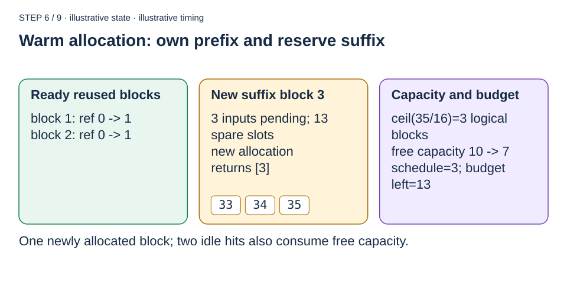

*Illustrative warm admission: three blocks of ownership, one newly allocated suffix block, three new computations. Idle prefix blocks also consume free capacity when attached.*

That last point matters when counting memory headroom. A cached block with reference count zero is an eviction candidate in the free queue. [`BlockPool.touch`](https://github.com/vllm-project/vllm/blob/d29f7f5c9294be8e489dac34d45a939b95a06336/vllm/v1/core/block_pool.py) removes it from that queue when a request acquires it, then increments its reference count. Therefore the admission check needs three units of free capacity here: one new block plus two idle hits being reclaimed from the free queue.

Our toy pool has 11 blocks, with block 0 reserved as the null placeholder. Ten are usable. Attaching blocks 1 and 2 and allocating block 3 leaves seven free. If only two were free at admission, this request could not proceed, despite requiring only one newly allocated block. The [original count method](https://github.com/vllm-project/vllm/blob/d29f7f5c9294be8e489dac34d45a939b95a06336/vllm/v1/core/single_type_kv_cache_manager.py) includes the idle prefix hits in precisely this capacity check.

The actual allocation branch gates capacity before attaching the reused blocks:

```python
# vllm/v1/core/kv_cache_manager.py  KVCacheManager.allocate_slots
        available_blocks = self.block_pool.get_num_free_blocks() - reserved_blocks
        required_blocks = num_blocks_to_allocate + watermark_blocks
        if required_blocks > available_blocks:
            # Cannot allocate new blocks
            return None

        if (
            new_computed_block_list is not self.empty_kv_cache_blocks.blocks
            or num_external_computed_tokens > 0
        ):
            # Append the new computed blocks to the request blocks until now to
            # avoid the case where the new blocks cannot be allocated.
            self.coordinator.allocate_new_computed_blocks(
                request_id=request.request_id,
                new_computed_blocks=new_computed_block_list,
                num_local_computed_tokens=num_local_computed_tokens,
                num_external_computed_tokens=num_external_computed_tokens,
            )
```

If the check returns `None`, this waiting request is not scheduled. Watermarks, full-sequence admission and in-flight reservations can add further constraints in the pinned version; full-sequence reservation is disabled here, no connector reservation exists, and the waiting admission has no running request that triggers the watermark. A running request with a reference to block 3 can process IDs 101 and 102 in its spare slots, so these two decode inputs allocate no fourth block.

## A registered hash is not proof that KV is ready

There are four different events to keep separate: compute a prefix hash, allocate block capacity, register that block in the hash index, and finish writing KV values during model execution.

The current [`KVCacheManager.allocate_slots`](https://github.com/vllm-project/vllm/blob/d29f7f5c9294be8e489dac34d45a939b95a06336/vllm/v1/core/kv_cache_manager.py) registers finalized full blocks during scheduling:

```python
# vllm/v1/core/kv_cache_manager.py  KVCacheManager.allocate_slots
        num_tokens_to_cache = min(
            total_computed_tokens + num_new_tokens,
            request.num_tokens,
        )
        self.coordinator.cache_blocks(request, num_tokens_to_cache)

        return self.create_kv_cache_blocks(new_blocks)
```

The group manager floors the cached-token count to full blocks, then [`BlockPool.cache_full_blocks`](https://github.com/vllm-project/vllm/blob/d29f7f5c9294be8e489dac34d45a939b95a06336/vllm/v1/core/block_pool.py) updates hash metadata. These functions perform bookkeeping; they do not run attention. In a cold run, block 1 can therefore have h1 registered after the first chunk is scheduled but before that chunk's GPU work completes.

The request's computed counter is also optimistic. [`Scheduler._update_after_schedule`](https://github.com/vllm-project/vllm/blob/d29f7f5c9294be8e489dac34d45a939b95a06336/vllm/v1/core/sched/scheduler.py) advances it before the executor completes, and tracks scheduled positions as in-flight. The name `num_computed_tokens` alone is not a readiness fence.

Our trace avoids an async inference claim. [`EngineCore.step`](https://github.com/vllm-project/vllm/blob/d29f7f5c9294be8e489dac34d45a939b95a06336/vllm/v1/engine/core.py) schedules, launches execution, waits for its result, handles separate sampling if needed, and processes the output. We assume that the warm producer completed before R arrived, and each of R's illustrated iterations completes before the next begins.

| Cold first chunk event | Hash-index state | New KV state |
|---|---|---|
| Allocate and schedule 16 inputs | h1 can already map to block 1 | pending |
| Model execution completes | h1 remains indexed | positions 0–15 ready |

This distinction is why a cache diagram should not turn a box green merely because its hash exists.

## Follow the same request through two decode steps

After final prefill completes, R has ready KV for prompt positions 0–34 and receives illustrative output ID 101. It now knows 36 IDs but has computed 35 inputs. Decode step one feeds 101, writes its KV in block 3 and samples 102. Decode step two feeds 102 in that same block and samples 103. At the end, 38 IDs are known and 37 input positions have computed KV; 103 is still a future input.

<details>
<summary>Read all 9 trace states as static figures</summary>

**1. R arrives: two alternative cache states**

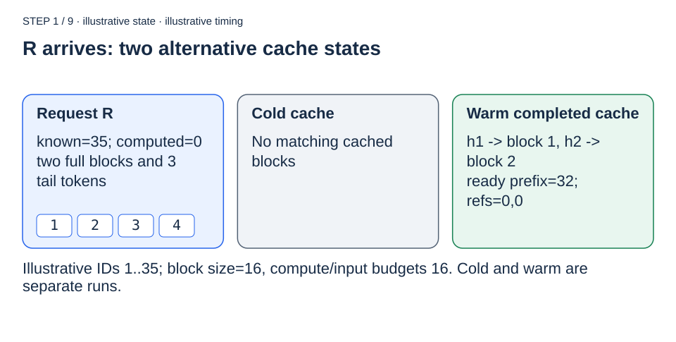

Illustrative IDs 1..35; block size=16, compute/input budgets 16. Cold and warm are separate runs.

**2. Cold schedule 1: reserve block 1**

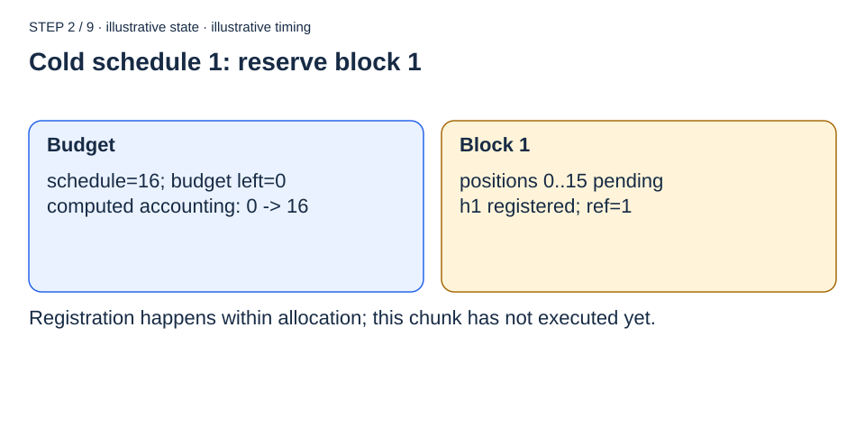

Registration happens within allocation; this chunk has not executed yet.

**3. Cold execute 1, then schedule 2**

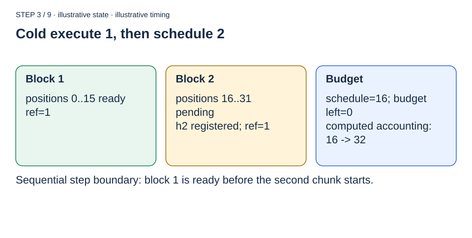

Sequential step boundary: block 1 is ready before the second chunk starts.

**4. Cold final prefill schedules 3 tail tokens**

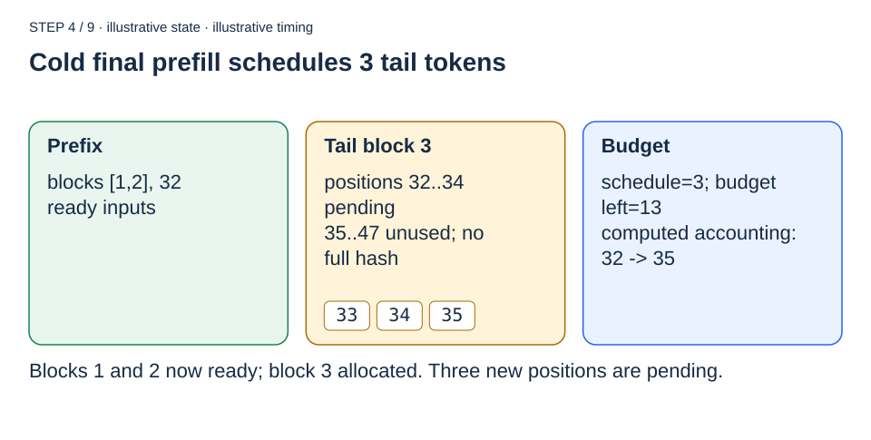

Blocks 1 and 2 now ready; block 3 allocated. Three new positions are pending.

**5. Warm lookup: skip 32 ready tokens**

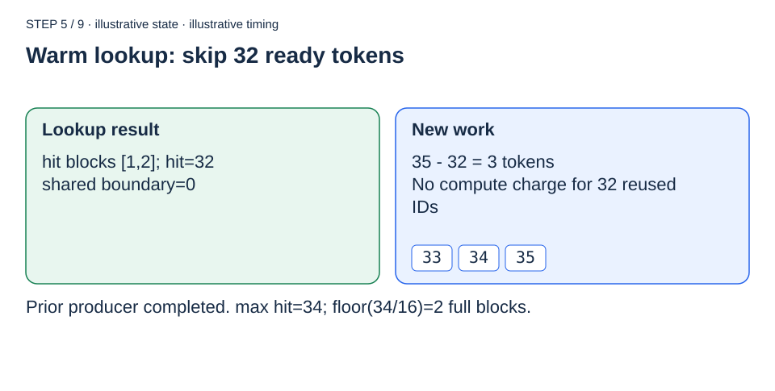

Prior producer completed. max hit=34; floor(34/16)=2 full blocks.

**6. Warm allocation: own prefix and reserve suffix**


One newly allocated block; two idle hits also consume free capacity.

**7. Either run: prefill completes and token 101 is sampled**

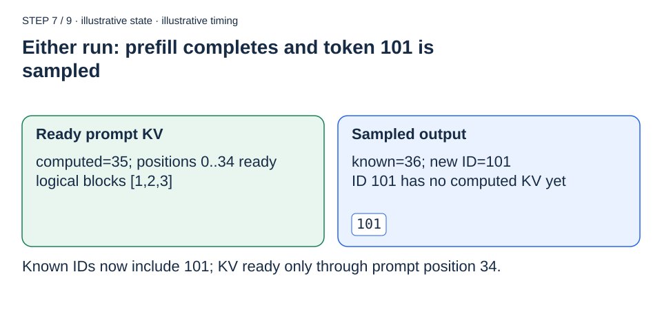

Known IDs now include 101; KV ready only through prompt position 34.

**8. Decode 1: feed 101, sample 102**

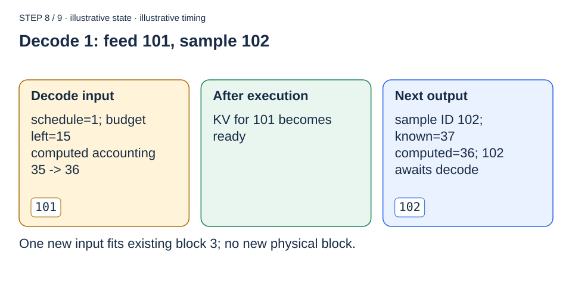

One new input fits existing block 3; no new physical block.

**9. Decode 2: feed 102, sample 103**

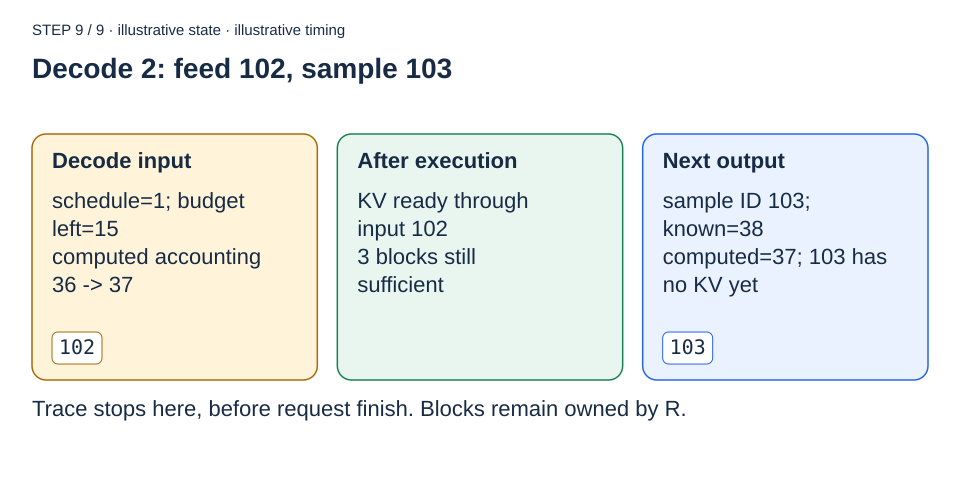

Trace stops here, before request finish. Blocks remain owned by R.

</details>

<iframe src="assets/cache-player.html" title="Cold and warm scheduler trace" height="720" sandbox="allow-scripts" loading="lazy"></iframe>

[Open the standalone state player](assets/cache-player.html). It has nine illustrative states, no autoplay and static fallbacks. Durations control presentation, not a measured latency. The editable [trace specification](assets/cache-trace.json) retains all example values.


*The final state stops before request completion. Three blocks still cover the inputs; the sampled output ID 103 has not been fed back yet.*


## What was checked

The [source contract script](source_contracts.py) executes original AST method bodies for full-attention lookup, manager lookup, capacity demand and allocation, plus four original running-token arithmetic statements. Eight grouped CPU contracts pass. They check the 32-token warm hit, a first-block miss, the exact-32 last-token cap, idle-hit capacity demand, successful allocation call order, allocation failure before attachment, and the selected count sequence. Full vLLM imports were unavailable: repository test collection failed at missing `tblib` in conftest, so no upstream tests executed.

The dependencies are explicit stand-ins: a cache map, spec, block pool and recording coordinator. This is not a complete scheduler run, real free-queue test, hashing-pipeline test, tokenizer run, model comparison or GPU KV-readiness test. The illustration's sampled IDs and readiness transitions remain source-reviewed or illustrative, never measured model outputs. Reproduce the limited CPU checks with `python source_contracts.py REPO_ROOT` from this article folder, and inspect the [recorded results](assets/source-contract-results.json) and [explanation evidence](evidence.json).

The Markdown source, original-method contracts and article manifest passed structural validation. First, middle and last SVG frames were rendered and inspected. Browser policy rejected the local HTML URL; Mermaid runtime rendering, desktop/mobile page layout, iframe controls and playback remain unverified. The standalone player and static SVGs are retained. The full scheduler lifecycle and real-model cached/uncached comparison remain open test gaps.

## Optional renderer demonstrations

The figures and state trace above explain this article's selected path. These
short clips demonstrate the optional Manim backend; they do not establish the
quality of a complete architecture, concurrency or mathematical explainer.
A real article does not need a video when its figures already teach the mechanism.

<details>
<summary>Show the optional rendering demos, GIF previews and MP4 links</summary>

### Illustrative cache lifecycle

[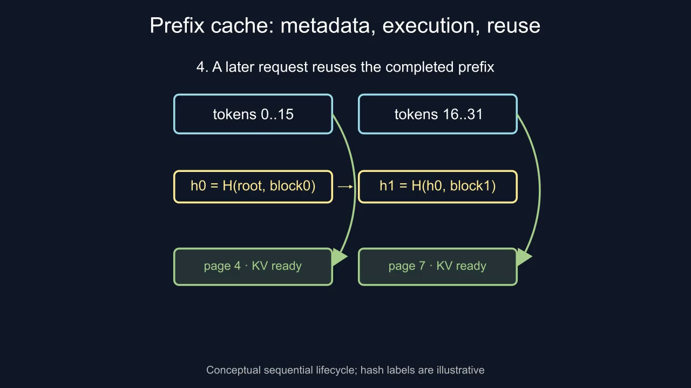](assets/cache-reuse.mp4?raw=1)

[Watch or download the MP4 (13.7 seconds)](assets/cache-reuse.mp4?raw=1).

<details>
<summary>Show animated GIF preview (loops automatically when visible)</summary>

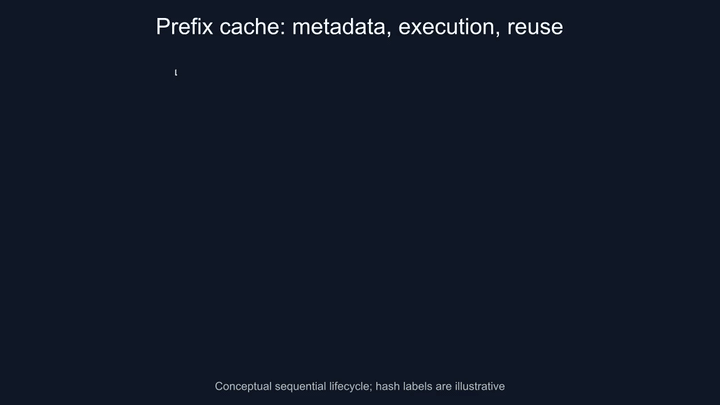

GIF timings are illustrative, as in the original clip. Use the MP4 for the full-resolution video.

</details>

<figure>
  <video controls playsinline preload="metadata" poster="assets/cache-reuse.poster.png">
    <source src="assets/cache-reuse.mp4" type="video/mp4">
    <a href="assets/cache-reuse.mp4">Open the cache lifecycle animation</a>
  </video>
  <figcaption>Original conceptual Manim scene: chained hash metadata, reserved pages, execution completion, then reuse by a later request. Hash labels and page IDs are illustrative, separate from the numbered trace above.</figcaption>
</figure>

The [editable scene specification](assets/cache-reuse.scene.json) and [original scene code](assets/cache-reuse.scene.py) and [reproducible source bundle](assets/cache-reuse.sources.zip) preserve this simplified model. The nine-state player above carries the precise budget and block counts. The MP4's timing is illustrative; it does not model concurrency, measure latency or establish real GPU readiness.

</details>
