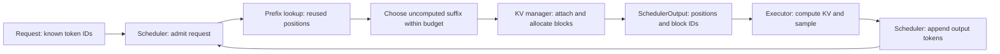
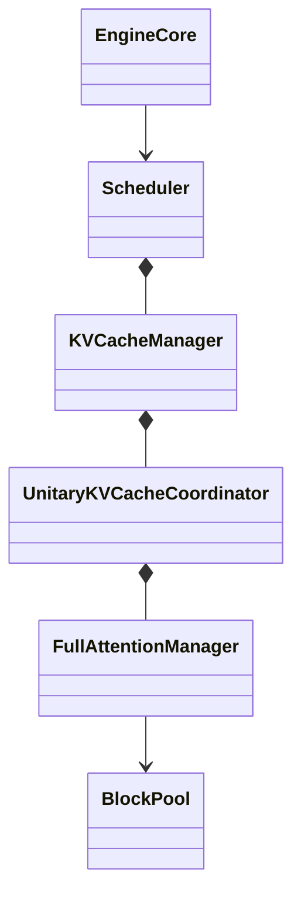
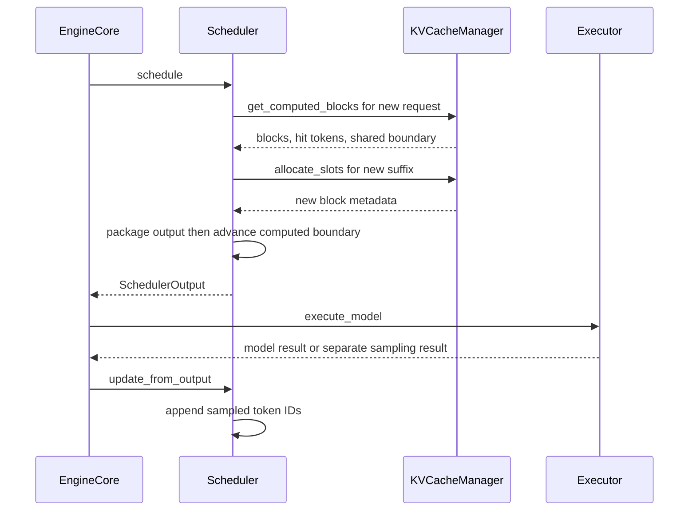

# vLLM V1: token budgets and KV blocks

This deep walkthrough follows one dense, decoder-only request through the synchronous V1 scheduler and one full-attention cache group. It starts with token IDs already in a `Request`. It ends after prefill and two decode steps, at the model-execution boundary.

Commit: `d29f7f5c9294be8e489dac34d45a939b95a06336`. Mode: `deep`. Audience: engineers reading the scheduler.
Source: [vLLM at the explained commit](https://github.com/vllm-project/vllm/tree/d29f7f5c9294be8e489dac34d45a939b95a06336). Scope excludes HTTP transport, tokenizer internals, checkpoint loading and model architecture.

## Contents

- [Mental model](#mental-model)
- [At a glance](#at-a-glance)
- [Big picture](#big-picture)
- [Running example](#running-example)
- [Doc map](#doc-map)
- [Major components](#major-components)
- [Key sequences](#key-sequences)
- [End-to-end data flow](#end-to-end-data-flow)
- [Test coverage](#test-coverage)
- [Gaps](#gaps)
- [Glossary](#glossary)
- [Shapes cheat sheet](#shapes-cheat-sheet)
- [Coverage of existing docs](#coverage-of-existing-docs)
- [Out of scope](#out-of-scope)
- [Refreshing this doc](#refreshing-this-doc)

## Mental model

1. The scheduler tracks how many known tokens still need computation.
2. Each iteration gives requests a compute-token budget and an input-token budget.
3. A prefix hit advances the request's starting position without spending that iteration's compute budget.
4. KV allocation still needs slots for the full prefix and the new suffix.
5. Cache metadata can register during scheduling, before the model writes KV tensors.
6. A sampled output token becomes known now, but its own KV usually arrives in the next decode step.

## At a glance

All values below are chosen for this illustrative example, not production defaults. `SchedulerConfig` in `vllm/config/scheduler.py` calls several field defaults testing conveniences; engine arguments can replace them.

| Knob | Value | Set in | What it changes |
|---|---:|---|---|
| `max_num_scheduled_tokens` | 16 | `vllm/config/scheduler.py` | Compute tokens per schedule |
| `max_num_batched_tokens` | 16 | `vllm/config/scheduler.py` | Input capacity per schedule |
| `long_prefill_token_threshold` | 0 | `vllm/config/scheduler.py` | Disables the extra long-prefill cap |
| `enable_chunked_prefill` | true | `vllm/config/scheduler.py` | Allows the prompt to span iterations |
| `max_num_seqs` | 1 | `vllm/config/scheduler.py` | One active request in the trace |
| `async_scheduling` | false | `vllm/config/scheduler.py` | Sequential example |
| `block_size`, hash block size | 16, 16 | Selected cache spec and manager input | Whole-block reuse |
| Pool size | 11 total, 10 usable | `BlockPool` in `vllm/v1/core/block_pool.py` | Block 0 is the null placeholder |
| `max_model_len` | 128 | Model config input | Maximum positions, not measured memory |

## Big picture

The diagram's arrows represent control and returned metadata. KV tensors live on the selected worker's GPU; CPU bookkeeping maps request positions to block IDs. The diagram does not claim GPU timing or overlap.

## Running example

The prompt is the constructed ID list `[1, 2, ..., 35]`. IDs `101`, `102`, and `103` represent illustrative sampled tokens. No tokenizer mapping, decoded text or model logits were measured. A full-attention dense model, such as the `facebook/opt-125m` scheduler test fixture, can motivate this path; the example does not load that checkpoint.

Before each schedule, `known` counts prompt plus sampled outputs. `computed` is the scheduler's current boundary after the previous synchronous iteration completed.

| Scenario and step | known | computed before | scheduled now | computed after schedule | output appended after execution |
|---|---:|---:|---:|---:|---|
| Cold R: prefill chunk 1 | 35 | 0 | 16 | 16 | none |
| Cold R: prefill chunk 2 | 35 | 16 | 16 | 32 | none |
| Cold R: final prefill | 35 | 32 | 3 | 35 | 101 |
| Cold R: decode 1 | 36 | 35 | 1 | 36 | 102 |
| Cold R: decode 2 | 37 | 36 | 1 | 37 | 103 |
| Warm R: final prefill | 35 | 32 from cache | 3 | 35 | 101 |
| Warm R: decode 1 | 36 | 35 | 1 | 36 | 102 |
| Warm R: decode 2 | 37 | 36 | 1 | 37 | 103 |

Cold and warm are alternative executions of the same request R. In the warm case a prior, completed request left matching blocks 1 and 2 idle in the cache. It is setup, not a simultaneous second request. The trace ends before R finishes, so its blocks remain referenced.

## Doc map

| Doc | Covers | Entry point | Read it when |
|---|---|---|---|
| [scheduler.md](scheduler.md) | Compute budgets and known/computed boundaries | `Scheduler.schedule` | Changing scheduling counts |
| [kv-cache.md](kv-cache.md) | Prefix lookup, allocation and cache registration | `KVCacheManager.get_computed_blocks` | Changing KV capacity or reuse |
| [Evidence ledger](evidence.json) | Source claims and verification boundaries | Persistent JSON | Revising or writing a companion article |
| [CPU contracts](tests/source_contracts.py) | Original AST methods with stand-ins | Standalone script | Rechecking toy numbers |

## Major components

| Component | File | Role | Called by | Calls |
|---|---|---|---|---|
| `EngineCore` | `vllm/v1/engine/core.py` | Schedule, execute, receive outputs | Engine loop | Scheduler and executor |
| `Scheduler` | `vllm/v1/core/sched/scheduler.py` | Request queues and token counts | EngineCore | KV manager |
| `KVCacheManager` | `vllm/v1/core/kv_cache_manager.py` | Capacity and group-level orchestration | Scheduler | Coordinator |
| `UnitaryKVCacheCoordinator` | `vllm/v1/core/kv_cache_coordinator.py` | One-group dispatch | KV manager | Full-attention manager |
| `FullAttentionManager` | `vllm/v1/core/single_type_kv_cache_manager.py` | Whole-prefix lookup | Coordinator | BlockPool |
| `BlockPool` | `vllm/v1/core/block_pool.py` | Ref counts, free queue and hash index | Group manager | Block metadata |

## Key sequences

This is the synchronous `EngineCore.step` path. A call returning a future does not make the example an async scheduler run: `step` waits for its result.

## End-to-end data flow

| Step | Input | Output | Code | Doc |
|---|---|---|---|---|
| sched.A1 | Known and computed positions | R schedules 16, 16, 3, 1, 1 on a miss | `Scheduler.schedule` | [scheduler.md](scheduler.md) |
| kv.A1 | R hashes and warm index | 32 reusable tokens, blocks 1 and 2 | `KVCacheManager.get_computed_blocks` | [kv-cache.md](kv-cache.md) |
| kv.A2 | Reused prefix plus 3 new tokens | 3 logical blocks, 1 newly allocated | `KVCacheManager.allocate_slots` | [kv-cache.md](kv-cache.md) |
| kv.A3 | Scheduled finalized token boundary | Full-block hash metadata registers before execution | `SingleTypeKVCacheManager.cache_blocks` | [kv-cache.md](kv-cache.md) |
| sched.A2 | Scheduled positions and sampled IDs | computed=35, known=36 after first output | `Scheduler._update_after_schedule` | [scheduler.md](scheduler.md) |

## Test coverage

| Step | Test | Command | Status |
|---|---|---|---|
| sched.A1 | Extracted original arithmetic | `python tests/source_contracts.py REPO_ROOT` from this doc folder | pass |
| kv.A1 | Original lookup methods, fake pool/spec | same standalone command | pass |
| kv.A2 | Original capacity and allocate methods, fake coordinator | same standalone command | pass |
| kv.A3 | Original allocate method's registration call order | same standalone command | pass |
| sched.A2 | Full request/output lifecycle | `pytest tests/v1/core/test_scheduler.py::test_schedule_concurrent_partial_requests -q` from source root | not run (needs deps: tblib, vLLM runtime) |
| kv.A1–kv.A3 | Repository prefix suite | `pytest tests/v1/core/test_prefix_caching.py::test_prefill -q` from source root | not run (needs deps: tblib, vLLM runtime) |

Summary: eight grouped standalone CPU contracts passed. These execute original AST bodies and selected arithmetic statements, with explicitly fake dependencies. They do not execute a complete `Scheduler.schedule`, instantiate vLLM, or write KV tensors. Upstream collection failed at the repository conftest import of `tblib`; no upstream test executed. The exact extraction inventory and file hashes are in [contract results](tests/source-contract-results.json).

## Gaps

| Step | Missing test or open question | Proposed test and assertion |
|---|---|---|
| sched.A1 / sched.A2 | Toy full scheduler lifecycle not executed | `test_single_request_35_tokens`: actual scheduler yields 16,16,3,1,1 with computed/known boundaries shown above |
| kv.A3 | Real KV readiness not tested | `test_completed_prefix_replay`: finish warm producer, compare reused-prefix logits with uncached run on GPU |
| kv.A2 | Real free queue and refcounts not executed by standalone tests | `test_idle_prefix_capacity`: two idle hits plus one new block reduce free count by three |

## Glossary

| Term | Meaning in this path | Code name |
|---|---|---|
| Known tokens | Prompt plus output IDs already stored | `Request.num_tokens` |
| Computed boundary | Optimistic scheduled-token accounting; not proof of finished GPU work | `Request.num_computed_tokens` |
| In-flight tokens | Scheduled positions not yet processed as outputs | `Request.num_in_flight_tokens` |
| Prefix hit | Reused initial KV positions from matching hash metadata | `get_computed_blocks` |
| Full block | 16 positions in this example | `block_size` |
| Cached block | Hash-indexed metadata; readiness also depends on execution ordering | `cached_block_hash_to_block` |
| Free block | Ref count zero, available for reuse or eviction | `free_block_queue` |

## Shapes cheat sheet

The source boundary here contains CPU metadata, not model-forward tensors. A physical cache block denotes per-layer KV storage, but bytes and backend tensor layout depend on model dimensions, dtype and attention backend; those values are not inferred.

| Object | Shape/type | Example | Location |
|---|---|---|---|
| Prompt IDs | `list[int]`, length P=35 | `[1,...,35]` | Request CPU memory |
| Cache group IDs | `tuple[list[int], ...]`, G=1 | `([1,2,3],)` | Scheduler metadata |
| Scheduled counts | `dict[str,int]`, one R | `{"R":3}` | SchedulerOutput CPU memory |
| Logical KV slots | ceil((hit+new)/16) blocks | 3 blocks cover 48 slots for 35 inputs | Metadata maps to worker GPU KV |

## Coverage of existing docs

| Topic | Existing doc | Covered here | Note |
|---|---|---|---|
| `hash_block_tokens` | `docs/design/prefix_caching.md` | kv.A1 | Hashes include preceding prefix |
| `get_computed_blocks` | same | kv.A1 | Current return has three values |
| `ref_cnt`, `free_block_queue` | same | kv.A2 | Idle hits consume free capacity when touched |
| `cache_full_blocks` | same | kv.A3 | Metadata registration precedes model execution |
| Eviction | same | Out of scope | No eviction in the running trace; allocation evicts cached free blocks in `BlockPool.get_new_blocks` |

The pinned implementation is authoritative for behavior. The existing design document remains useful context but does not replace the current method signatures or branch order.

## Out of scope

| Branch | Why excluded | Source family |
|---|---|---|
| Priority preemption and pressure | One request, sufficient capacity | `Scheduler.schedule` |
| Speculative/diffusion tokens | Dense autoregressive case without drafts | Same scheduler |
| Fine-grained partial prefix reuse and CoW | Hash granularity equals physical block size | `FullAttentionManager.find_longest_cache_hit` |
| Hybrid Mamba/sliding attention | One full-attention group | Hybrid coordinator and group managers |
| Async and KV connectors | Producer completed before R arrives | Engine batch queue and connector paths |
| HTTP/SSE, tokenizer and weights | Start at Request, stop at executor boundary | Entry points and worker modules |
| Model architecture and kernels | Scheduling question does not require forward math | Model and attention implementations |

## Refreshing this doc

Run the skill scanner and checker against the pinned source. Re-run `python tests/source_contracts.py REPO_ROOT` from the document folder using an existing Python environment. Generated HTML needs CDN access for Mermaid and highlighting. Preserve [evidence.json](evidence.json) and the trace JSON when revising.
